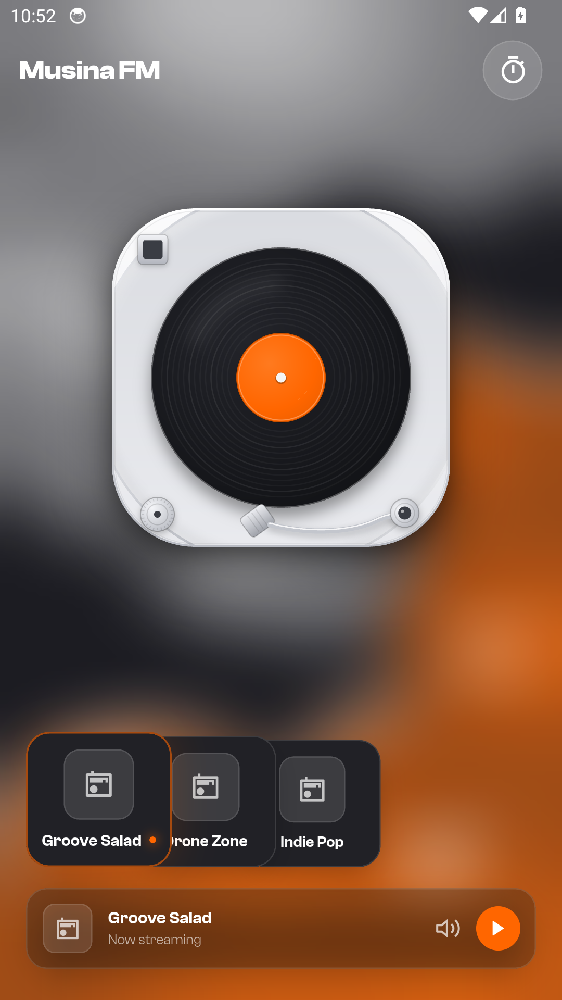
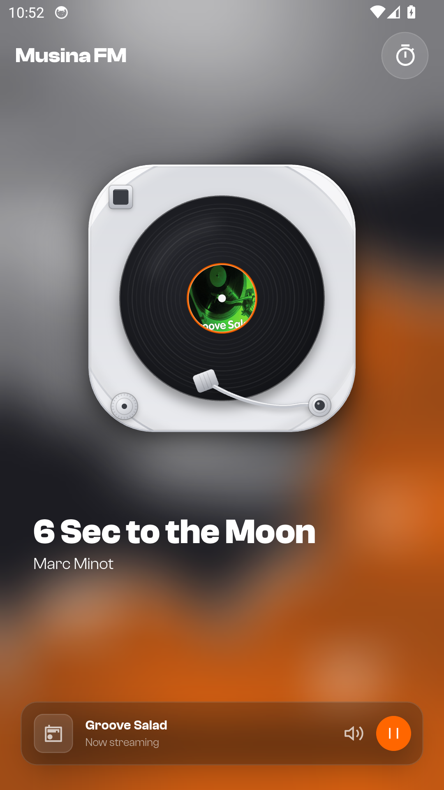

# Musina FM — Feature Guide

Can you handle the Heat?

> This guide is generated automatically on every merge: CI builds the
> app, walks the guided tour on an Android emulator, and captures
> each screen below.

## 1. Your station, live

Musina FM opens into the player - artwork, track and transport one tap from on
air, stations fanned above the now-playing pill.

## 2. Press play

One tap and the station is on air - it keeps playing on the lock screen with the
app closed.
